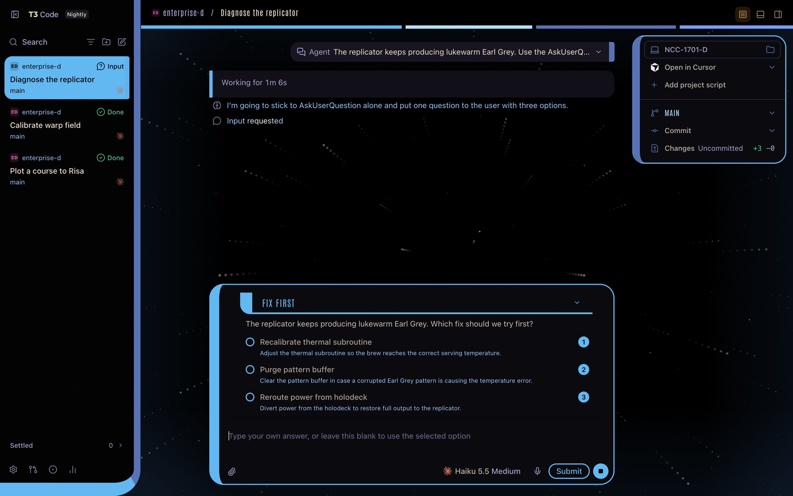
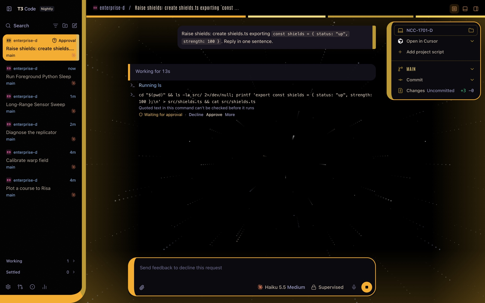
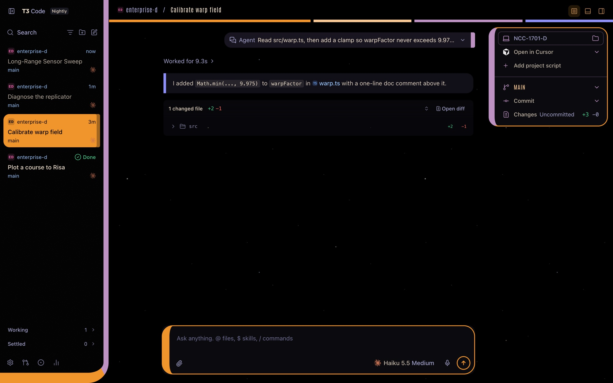
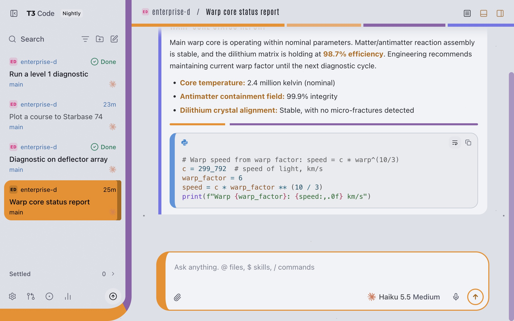
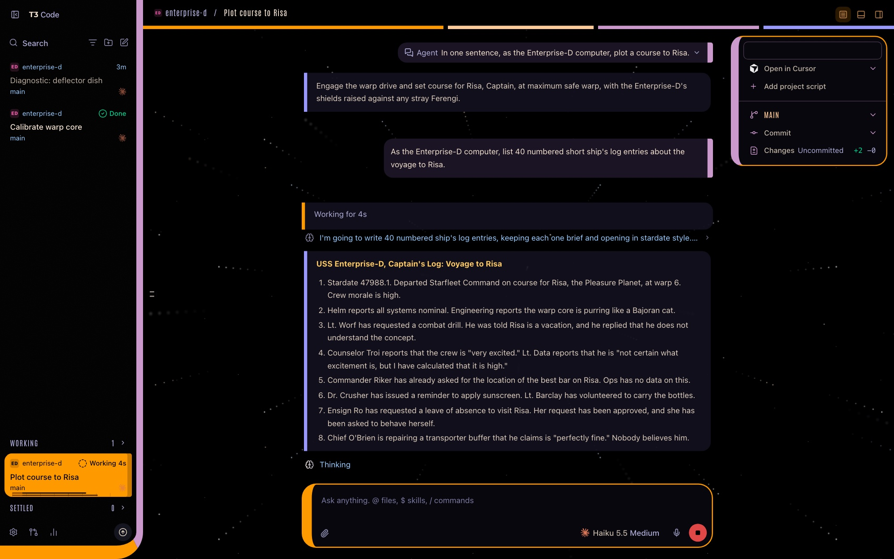
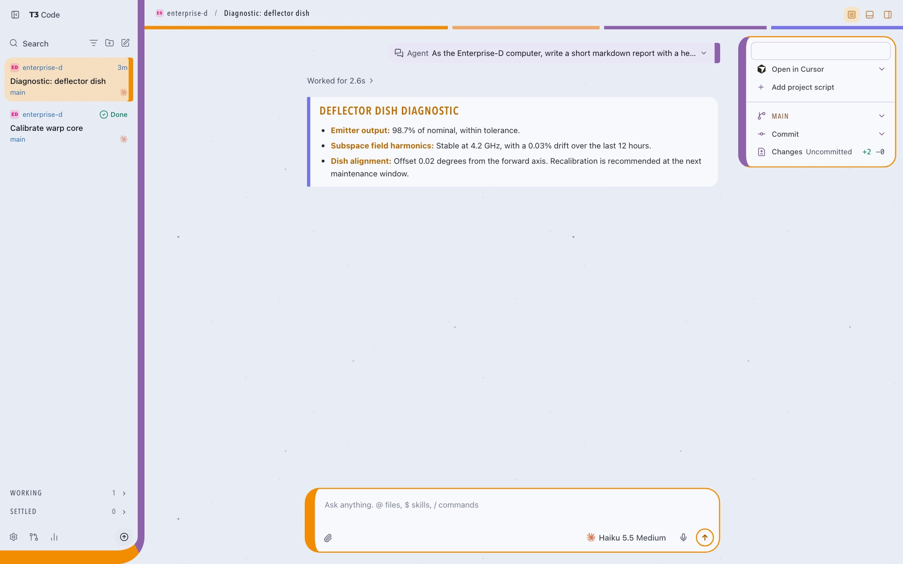
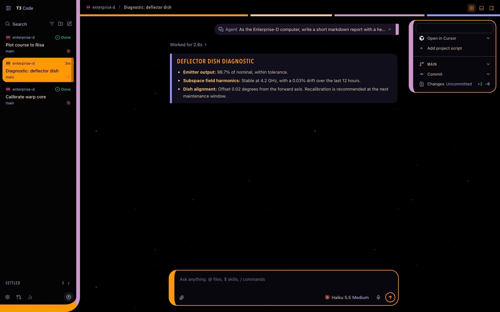

# LCARS for T3 Code

A Star Trek: The Next Generation–style (LCARS) theme for [T3 Code](https://github.com/pingdotgg/t3code), with optional ship sounds for Claude Code.

The theme draws an LCARS frame around the app, runs a starfield that goes to warp while Claude works, and fades in hail, yellow alert and red alert when a thread needs you.


| Incoming hail: a thread needs input | Yellow alert: a thread needs approval | Red alert: a thread failed |
|---|---|---|
|  |  |  |

**On T3 Code Stable 0.1.10?** The full theme needs T3 Code Nightly `0.1.11-nightly.20261117.4825` or later. Stable 0.1.10 limits theme CSS to 50,000 characters, so `install.sh` offers a compact build instead. See [T3 Code Stable 0.1.10](#t3-code-stable-0110).

## Copy/paste prompt

Paste one of these into a T3 Code thread. Claude does the rest.

**Theme only**

```text
Install the LCARS theme for T3 Code from https://github.com/peter-lewis/t3-lcars-theme.
Clone it to ~/dev/t3-lcars-theme (or pull it if it's already there), read its README, run ./install.sh,
then switch T3 Code to the "lcars" theme. If the installer asks for a choice, ask me.
```

**Theme and sounds** (macOS)

```text
Install the LCARS theme and sounds for T3 Code from https://github.com/peter-lewis/t3-lcars-theme.
Clone it to ~/dev/t3-lcars-theme (or pull it if it's already there), read its README, run ./install.sh --sounds,
then switch T3 Code to the "lcars" theme. If the installer asks for a choice, ask me.
```

**Uninstall**

```text
Uninstall the LCARS theme from https://github.com/peter-lewis/t3-lcars-theme: switch T3 Code back to the
"t3-code" theme, then run ./uninstall.sh from ~/dev/t3-lcars-theme.
```

## What you get

- **LCARS frame.** The sidebar ends in an LCARS elbow. Chats, replies, the composer, question cards and the thread details panel get LCARS panels, endcaps and segmented meters, set in the condensed Antonio typeface.
- **Status cards.** A working thread's sidebar card shows moving bar meters and a blinking endcap. A waiting thread shows thin standby cells.
- **Starfield.** Stars drift slowly behind the chat and jump to warp while the open thread is working.
- **Alert states.** These fade in on their own and clear when the condition does. The most severe one wins.

  | Condition | Alert | Color |
  |---|---|---|
  | A thread needs your input | Incoming hail | Blue |
  | A thread needs approval | Yellow alert | Amber |
  | A thread has failed | Red alert | Red |

  The stop button, the Submit button, the scrollbars and the glow follow the alert color.
- **Snoozed threads.** Snoozed rows get a dim violet card with a steady endcap instead of the working meters, the shelf headers use LCARS caps, and the Snoozed / Settled line under the chat becomes an LCARS strip with a Wake now / Un-settle key.
- **Approval keys.** When a command waits for approval, Approve is a solid LCARS key in the alert color, Decline a red outline key and More a small outline key.
- **Light and dark.** In light appearance the console turns a pale, cool grey: LCARS bars on near-white panels with a deeper lavender, ink-speck stars that still go to warp, and darker alert hues so hail, yellow and red alert stay readable. T3 Code switches between them with its color scheme setting.
- **Reduced motion.** Animations stop when macOS *Reduce motion* is on.



| Light: at rest | Light: warp | Light: red alert |
|---|---|---|
|  |  |  |

There is also `lcars-red-alert`, a manual variant that keeps the whole app in red alert until you switch back.

## Install by hand

```sh
git clone https://github.com/peter-lewis/t3-lcars-theme ~/dev/t3-lcars-theme
cd ~/dev/t3-lcars-theme
./install.sh            # theme only
./install.sh --sounds   # theme and sounds (macOS)
```

Then choose **LCARS** in T3 Code's theme settings. On T3 Code Stable 0.1.10, `install.sh` asks which compact build you want; see [T3 Code Stable 0.1.10](#t3-code-stable-0110).

## T3 Code Stable 0.1.10

Stable 0.1.10, and nightlies before `0.1.11-nightly.20261117.4825`, limit theme CSS to 50,000 characters. The full theme needs about 83,000, so T3 Code leaves it out of the theme list without an error. When `install.sh` finds one of these versions, it offers a compact build that fits. Each compact build leaves out one feature:

| Choice | Flag | Leaves out |
|---|---|---|
| Dark mode only, with the LCARS font (recommended) | `--compact dark` | Light mode. Light appearance shows the dark console. |
| Light and dark mode, in the system font | `--compact nofont` | The Antonio font. Labels use Avenir Next Condensed. |

Red alert is dark only already, so its compact build is complete. Everything else matches the full theme: the dark build and red alert render pixel for pixel the same as the full theme in dark mode.

In a terminal, `install.sh` shows a menu. Run by an agent, it installs nothing, exits with status 2, and prints the choices for the agent to ask you about. To choose up front, run `./install.sh --compact dark` or `./install.sh --compact nofont`. After you update T3 Code, run `./install.sh` again to get the full theme.

| Dark only, at warp | System font, light | System font, dark |
|---|---|---|
|  |  |  |

The compact builds in `themes/compact/` are generated. Run `python3 tools/compact.py` after changing `themes/*.json`; it fails if a build goes over 50,000 characters.

`install.sh` copies the themes into `~/.t3/userdata/themes/`. They are copies, not symlinks, because T3 Code ignores symlinked themes. Re-run it after `git pull` to update. Anything it replaces is backed up next to the original as `*.bak-<timestamp>`.

**To turn the theme off,** pick any other theme. **To remove everything,** switch themes first, then run `./uninstall.sh`.

## Sounds (optional, macOS)

The sounds are [Claude Code hooks](https://docs.claude.com/en/docs/claude-code/hooks), so they work in T3 Code and in the `claude` CLI. The scripts synthesize all the audio; no samples are used.

| When | Sound |
|---|---|
| You send a prompt | Computer acknowledgement beep, then a quiet engine hum that fades in |
| Claude asks a question or needs permission | Hail chirp |
| Claude finishes | The hum fades out, then a completion beep |

Several sessions working at once share one hum. The hum stops on its own after 30 minutes.

`./install.sh --sounds` does the following:

1. Copies the scripts in `sounds/` to `~/.claude/hooks/lcars-sounds/` and generates the WAV files there.
2. Adds the `/sounds` command at `~/.claude/commands/sounds.md`.
3. Adds four hook entries to `~/.claude/settings.json` through `sounds/hooks.py`. Your other settings and hooks are left alone, and a backup is written first.

Restart Claude Code, or start a new T3 thread, to load the hooks.

**Turn them on and off** with `/sounds off`, `/sounds on`, `/sounds status`, or plain `/sounds` to flip. Without the command, run `python3 ~/.claude/hooks/lcars-sounds/toggle.py off`.

To change the sounds, edit `make_beeps.py` or `make_hum.py` and run `./install.sh --sounds` again.

### Use your own sounds

You can swap any sound for an audio file you like, such as clips from [TrekCore's audio library](https://www.trekcore.com/audio/). This repo does not include or download those clips. You download the ones you want in your browser, for your own use, and point the theme at them:

```
/sounds use hail ~/Downloads/tng_hail.mp3
/sounds use done ~/Downloads/computer_beep.mp3
/sounds reset hail      # back to the built-in chirp; /sounds reset resets every slot
/sounds status          # shows which slots use your files
```

| Slot | Plays when | Tips |
|---|---|---|
| `ack` | You send a prompt | A short beep under a second works best |
| `hail` | Claude asks a question or needs permission | A hail whistle or comm chirp |
| `done` | Claude finishes | A short beep or chirp |
| `hum` | Loops while Claude works | A seamless engine or bridge ambience loop. It plays at low volume |
| `hum_in`, `hum_out` | Hum starts and stops | Optional. With a custom `hum` and no custom fades, the hum starts and stops without them |

`/sounds use` plays the file once as a preview (unless sounds are off) and copies it to `~/.claude/lcars-sounds-custom/<slot>.<ext>`, so you can delete the download. Reinstalling or updating keeps your files. You can also put files in that folder yourself, named after the slot. Formats: `.wav`, `.mp3`, `.m4a`, `.aac`, `.aif`, `.aiff`, `.caf`.

**Or ask Claude to do it.** TrekCore blocks automated downloads, so download the clips yourself first, then paste something like:

```text
I downloaded some Star Trek sound clips to ~/Downloads. Set them up as my LCARS sounds:
use the hail whistle for "hail", the short computer beep for "ack", the chirp for "done",
and the engine ambience for "hum". Use ~/.claude/hooks/lcars-sounds/toggle.py use <slot> <file>
for each one, then run its status command and show me the result.
```

## For agents installing this

If you are an AI agent following one of the prompts above:

1. Clone or pull the repo, then run `./install.sh`, adding `--sounds` only if the user asked for sounds.
2. If `install.sh` exits with status 2 and prints `LCARS INSTALL NEEDS A CHOICE FROM THE USER`, T3 Code is too old for the full theme and nothing was installed. Ask the user which version they want, with your question tool if you have one (`AskUserQuestion` in Claude Code), offering the options in the order printed. Run the command for their answer. Do not choose for them, and do not edit or minify the theme files yourself.
3. Switch the theme. In T3 Code, call `t3_theme_set` with `themeId: "lcars"` if you have it. Otherwise tell the user to choose **LCARS** in T3 Code's theme settings. If `t3_theme_set` reports a 50,000-character limit, run `./install.sh` again without flags and go back to step 2.
4. If you installed sounds, tell the user that `/sounds off` turns them off, that `/sounds use <slot> <file>` swaps in their own audio (see [Use your own sounds](#use-your-own-sounds)), and that the hooks load in new sessions. Do not download sound clips for the user from third-party sites; they pick and download their own.
5. To uninstall, switch the theme back to `t3-code` first, then run `./uninstall.sh`.

Do not symlink the theme files into `~/.t3/userdata/themes/`; T3 Code will not list them.

## Customizing

The whole theme is CSS inside `themes/lcars.json`. Edit the installed copy in `~/.t3/userdata/themes/`, then re-select the theme in T3 Code to reload it. Copy the file back into `themes/` when you're happy with it.

Helper scripts in `tools/`:

- `alerts.py <theme.json> [hail_icon yellow_icon red_icon]` regenerates the alert block at the end of the CSS, which is everything from `/* Ship alert states`. Passing other icon names lets you preview a look. For example, `python3 tools/alerts.py themes/lcars.json test-none message-circle-question-mark test-none` makes a question trigger yellow alert. Run it without icon names to restore the real triggers.
- `light.py themes/lcars.json` regenerates the light palette (`variants.light`) and the light-mode block, which sits just before `/* Ship alert states`. Every light colour comes from the `TOKENS` dict at the top, so retune it there, then re-run the script.
- `redalert.py themes/lcars.json themes/lcars-red-alert.json` rebuilds the red variant by color mapping. The red variant is dark only.
- `embed.py <theme.json> fonts/antonio.woff2` embeds the font.
- `compact.py` rebuilds `themes/compact/` for T3 Code Stable 0.1.10. See [T3 Code Stable 0.1.10](#t3-code-stable-0110).

### How it works

Everything is CSS keyed to T3 Code's markup:

- **Alerts** use `:root:has()` on the sidebar status icons. Input is `.lucide-message-circle-question-mark`, approval is `.lucide-shield-question-mark` and failed is `.lucide-circle-alert`.
- **Warp** runs while `button[aria-label="Stop generation"]` exists.
- **Stars and glow** sit on `[data-slot="sidebar-wrapper"]`, with the chat's wrappers made transparent so the LCARS elbow is the true edge.
- **Light mode** rules are scoped to `html:not(.dark)`, because T3 Code drops the `dark` class in light appearance. Star colors are the `--lc-s1`..`--lc-s3` variables, so light mode recolors the starfield without repeating it. Theme CSS is capped at 100,000 characters.
- **Fades** use registered `@property` color variables, so palette changes transition smoothly.

The selectors were found in T3 Code's bundle. To look yourself, run `npx @electron/asar extract "/Applications/T3 Code.app/Contents/Resources/app.asar" out`.

## Compatibility

Built against T3 Code Nightly in November 2026. It needs `0.1.11-nightly.20261117.4825` or later, the first build whose theme CSS cap is 100,000 characters ([pingdotgg/t3code#37781](https://github.com/pingdotgg/t3code/pull/37781)). On T3 Code Stable 0.1.10, which caps it at 50,000, install a [compact build](#t3-code-stable-0110). The theme depends on T3 Code's internal markup, so an update can break parts of it. Issues and pull requests are welcome.

## Credits and license

- Theme, scripts and sounds: [MIT](LICENSE).
- [Antonio](https://github.com/googlefonts/antonioFont) font: SIL Open Font License 1.1 ([`fonts/OFL.txt`](fonts/OFL.txt)), embedded in the theme.

This is an unofficial fan project. It is not affiliated with or endorsed by Paramount or CBS Studios. Star Trek and LCARS are their trademarks.
